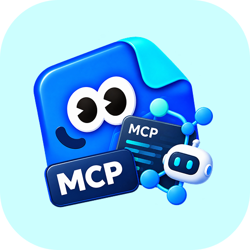
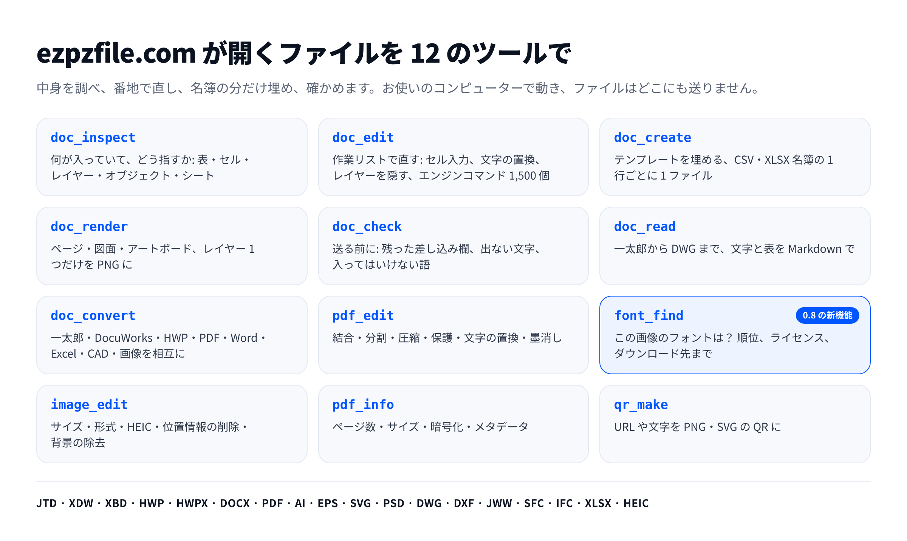

<p align="center">
  
</p>
<h1 align="center">ezpzfile-mcp</h1>
<p align="center"><a href="README.md">English</a> · <a href="README.ko.md">한국어</a> · <b>日本語</b></p>
<p align="center">
  <a href="https://ezpzfile.com/ja/mcp"></a>
</p>
<p align="center">
  <a href="https://www.npmjs.com/package/ezpzfile-mcp"></a>
  
  
  <a href="LICENSE"></a>
</p>

**AI エージェントのためのファイルツール: 文書の中身を調べ、番地で直し、名簿の分だけ埋め、結果を確かめます。**
一太郎・DocuWorks を Windows なしで、Illustrator・Photoshop のファイルを Adobe なしで、DWG・Jw_cad を AutoCAD なしで、
韓国の HWP・HWPX をハンコムオフィスなしで。DOCX・PDF・Excel・画像、フォント検索も。
すべてお使いのコンピューターで動き、ファイルはどこにも送りません。

```bash
claude mcp add ezpzfile -- npx -y ezpzfile-mcp
```

<sub>バージョン 0.8.0 · Node 22.13 以上 · Claude Desktop、Cursor、VS Code は<a href="https://ezpzfile.com/ja/mcp">ガイド</a>を参照</sub>

[](mcp/README.md#tools)

## どれだけ節約できるか

同じ 4 つのファイルを 2 つのセッションに置き、同じモデルに同じ文で作業を頼みました。片方はこのサーバーだけを使え、もう片方は専用ツールなしでシェルと Node を自由に使いました。

| | ツールなし | ezpzfile-mcp あり |
|---|---|---|
| 費用 | $0.28 | **$0.13** |
| 所要時間 | 9:06 | **0:39** |
| 完了したタスク | 2 / 4 | **4 / 4** |
| ツール呼び出し | 20 | **10** |
| トークン | 510,607 | **184,605** |

費用は 53%、時間は 93% 減りました。トークンと費用は概算ではなく、セッションがメッセージごとに記録した値の合計です。2026-09-12 に計測。ツールなしの側は韓国語の文書 2 つに使うライブラリを探すうちに時間を使い切り、2 つのタスクは始めることもできませんでした。この差は「少なくともこれだけ」と読んでください。

## こんな人のために

エージェントと同じやり方で実行した実際の作業です。`test/make-samples.py` が作るファイルで `node test/bench.mjs` を実行しました（Node 22.22.0, linux, 2 cores、2026-11-05）。「初回」には一度だけのダウンロード（デザインエンジン、フォント検索モデル、足りないフォント）が含まれます。

| 誰が | 作業 | 初回 | 2 回目 | 結果 |
| --- | --- | --- | --- | --- |
| 事務（韓国） | HWP の表をすべて読む | 267 ms | 18 ms | 表を Markdown で、結合セルもそのまま |
| 事務（韓国） | HWP の書式を埋めて PDF に、確認まで | 1.3 s | 388 ms | 3 回の呼び出し、差し込み欄の残りなし |
| 営業 | DOCX の見積書テンプレートを埋める（分割された差し込み欄、品目行） | 374 ms | 348 ms | 1 回の呼び出し、1 行追加、残りなし |
| 営業 | PDF デザインと名簿から見積書 100 枚 | 12.9 s | 6.7 s | 100 ファイル、1 枚 50 KB、確認済み |
| デザイン | SVG/AI デザインと名簿から名刺 100 枚 | 18 ms | 11 ms | 100 ファイル |
| デザイン | PSD のレイヤーを 1 つ隠して PNG に | 1.1 s | 1.0 s | 2 回の呼び出し、レイヤー 7 個、確認済み |
| デザイン | この画像のフォントは？ | 6.0 s | 751 ms | 1 位 Nanum Myeongjo 92% |
| デザイン | 入っていないフォントの PDF で名前を変える | 836 ms | 92 ms | 同じフォントを取得して使用、67 KB |
| 個人情報 | PDF の氏名・電話・住所を墨消し、証明まで | 1.3 s | 914 ms | 2 回の呼び出し、取り出せる文字なし |
| 建築 | CAD 図面: レイヤー、文字、ベクター PDF | 38 ms | 20 ms | 3 回の呼び出し、文字は文字のまま |

- **日本・韓国の事務職:** 一太郎・DocuWorks・HWP・HWPX を読み、埋め、表のセル単位で直し、変換します。
- **営業・総務:** DOCX・HWP・PDF のテンプレートから見積書・証明書・文書を、1 枚でも Excel 名簿の行ごとにでも作ります。
- **デザイナー・マーケター:** AI・SVG・PSD をレイヤー単位で直し、名簿の全員分の名刺・ポスターを作り、参考画像のフォントを探します。
- **法務・個人情報:** PDF から文字を本当に消す墨消しと、取り出せる文字がないことの確認まで。
- **建築・設計:** DWG・DXF・Jw_cad・IFC・STEP を読み、文字が文字のままのベクター PDF に出力します。

## MCP とスクリプト

このサーバーなしでエージェントがやる方法、つまりよく使われる Python ライブラリでスクリプトを書き、同じファイルで動かした結果です。

| 作業 | ezpzfile-mcp | エージェントが書くスクリプト |
| --- | --- | --- |
| DOCX 見積書テンプレートを埋める | 1 回、0.1 秒、残りなし | python-docx: Word が 2 つに分けた `{{customer}}` は埋まらない |
| PDF の氏名・電話番号を墨消し | 1 回、1 秒、文字を削除、確認済み | pypdf + reportlab の黒い四角: 隠れて見えるが氏名はそのまま取り出せる |
| PDF デザインと名簿から見積書 100 枚 | 1 回、7 秒、1 枚 50 KB | pypdf + reportlab の重ね書き: 位置は手で測り、`{{owner}}` が全ファイルの文字に残る |
| HWP の表のセルを直す | 1 回、開き直して確認 | HWP の表を書ける公開ライブラリはない |
| PSD のレイヤーを隠して PNG に | 2 回、0.9 秒 | psd-tools も得意（3.3 秒）。文字レイヤーの内容は変えられない |
| DXF を PDF に | 1 回、16 ms、文字は文字のまま | ezdxf + matplotlib（1.2 秒）: 文字層なし。DWG はクローズドな ODA 変換ツールが先に必要 |
| この画像のフォントは？ | 1 回、0.8 秒、順位とライセンス付き | 画像からフォントを見分ける公開ライブラリはない |

## 0.8.0 の新機能

- **`font_find`**: 画像や文書 1 ページの文字を、10 の文字体系・約 1 万のフォントと照らし合わせます。[ezpzfile.com のフォント検索](https://ezpzfile.com/ja/fonts)と同じ方法です。
- **足りないフォントは名前で取得**: PDF テンプレートのフォントが入っておらず、無料の Google Fonts なら一度だけ取得してそのフォントで書きます。似た別のフォントには置き換えません。
- **名簿 PDF が軽く**: 見積書 100 枚が 1 枚 757 KB から 50 KB に、43 秒から 7 秒に。

すべての履歴: [Releases](https://github.com/ezpzfile/ezpzfile-mcp/releases)。

## 構成

| パス | 内容 |
|---|---|
| [`mcp/`](./mcp) | パッケージ: サーバー、ツール、テスト、ビルド。全ツールと引数は [`mcp/README.md`](./mcp/README.md)（英語） |
| `src/lib/` | [ezpzfile.com](https://ezpzfile.com) と共有するコード: HWP、PDF、CAD、フォント検索 |
| `engines/` | ベクター・PSD エンジンを WASI 向けにビルドするパッチ |
| `public/vendor/` | HWP・JTD・XDW エンジン、libheif、同梱フォント（git にはなく npm パッケージに入っています） |

```bash
cd mcp
npm install
npm run build                            # mcp/dist/index.js, mcp/vendor/
python3 test/make-samples.py /tmp/samples
node test/protocol.mjs /tmp/samples      # 全ツール
node test/scenarios.mjs /tmp/samples     # エージェントのようにつなげる作業
node test/bench.mjs /tmp/samples         # 上の計測表
```

ネットワークは一度だけのダウンロードにしか使わず、何も送信しません: 背景除去モデル、デザインエンジン、フォント検索のモデルと一覧、PDF テンプレートが名前で指定する無料フォント。フォントの取得は `EZPZFILE_NO_FONT_DOWNLOAD=1` で止められます。

## このリポジトリについて

読み取り専用の書き出し版です。作業用のコピーはウェブサイトと一緒に非公開リポジトリにあり、このリポジトリはリリースのたびにそこから作り直します。プルリクエストより Issue でお知らせください。

MIT ライセンス、[LICENSE](./LICENSE) を参照。同梱のエンジンとフォントはそれぞれのライセンスに従います。
