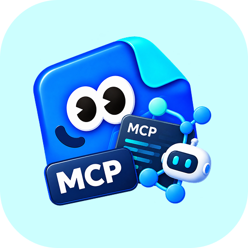
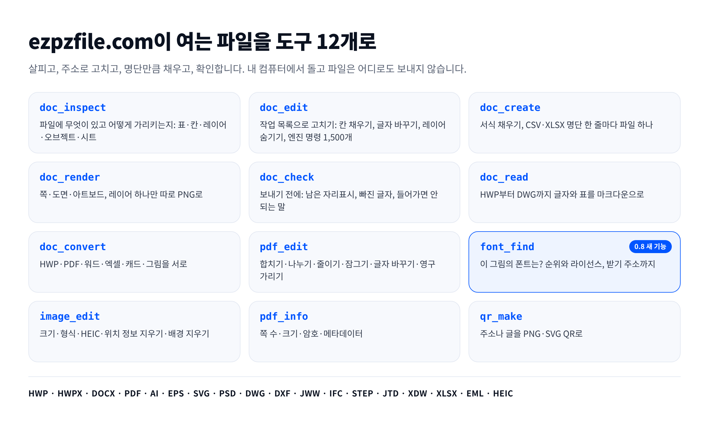

<p align="center">
  
</p>
<h1 align="center">ezpzfile-mcp</h1>
<p align="center"><a href="README.md">English</a> · <b>한국어</b></p>
<p align="center">
  <a href="https://ezpzfile.com/ko/mcp"></a>
</p>
<p align="center">
  <a href="https://www.npmjs.com/package/ezpzfile-mcp"></a>
  
  
  <a href="LICENSE"></a>
</p>

**AI 에이전트를 위한 파일 도구: 문서 안을 살피고, 주소로 고치고, 명단만큼 채우고, 결과를 확인합니다.**
한컴오피스 없이 HWP·HWPX, 어도비 없이 일러스트레이터·포토샵 파일, 오토캐드 없이 DWG·Jw_cad,
윈도우 없이 이치타로·DocuWorks, 그리고 DOCX·PDF·엑셀·그림과 폰트 찾기까지.
모두 내 컴퓨터에서 돌고 파일은 어디로도 보내지 않습니다.

```bash
claude mcp add ezpzfile -- npx -y ezpzfile-mcp
```

<sub>0.8.0판 · Node 22.13 이상 · Claude Desktop, Cursor, VS Code는 <a href="https://ezpzfile.com/ko/mcp">안내</a>를 보세요</sub>

[](mcp/README.md#tools)

## 얼마나 아끼나

같은 파일 네 개를 두 세션에 넣고 같은 모델에 같은 문장으로 일을 맡겼습니다. 한쪽은 이 서버만 쓸 수 있고, 다른 쪽은 전용 도구 없이 셸과 Node를 마음대로 썼습니다.

| | 도구 없이 | ezpzfile-mcp로 |
|---|---|---|
| 비용 | $0.28 | **$0.13** |
| 걸린 시간 | 9:06 | **0:39** |
| 끝낸 일 | 2 / 4 | **4 / 4** |
| 도구 호출 | 20 | **10** |
| 토큰 | 510,607 | **184,605** |

비용은 53%, 시간은 93% 줄었습니다. 토큰과 비용은 어림값이 아니라 세션이 메시지마다 기록한 값을 더한 것입니다. 2026-09-12에 쟀습니다. 도구 없는 쪽은 한글 문서 두 개에 쓸 라이브러리를 찾다가 시간을 다 써서 두 일은 시작도 못 했습니다. 그러니 이 차이는 적어도 이만큼이라는 뜻입니다.

## 누가 쓰나

에이전트가 하는 방식 그대로 돌린 실제 일입니다. `test/make-samples.py`가 만든 파일로 `node test/bench.mjs`를 돌렸습니다(Node 22.22.0, linux, 2 cores, 2026-11-05). "처음"에는 한 번만 받는 것(디자인 엔진, 폰트 찾기 모델, 없는 폰트)이 들어 있습니다.

| 누가 | 일 | 처음 | 다시 | 결과 |
| --- | --- | --- | --- | --- |
| 사무 | HWP 표를 모두 읽기 | 267 ms | 18 ms | 표를 마크다운으로, 합친 칸 그대로 |
| 사무 | HWP 서식 채우고 PDF로, 확인까지 | 1.3 s | 388 ms | 3번 호출, 남은 자리표시 없음 |
| 영업 | DOCX 견적서 서식 채우기 (쪼개진 자리표시, 품목 줄) | 374 ms | 348 ms | 1번 호출, 줄 1개 추가, 남은 것 없음 |
| 영업 | PDF 시안 하나와 명단으로 견적서 100장 | 12.9 s | 6.7 s | 100개, 한 장 50 KB, 확인됨 |
| 디자인 | SVG/AI 시안 하나와 명단으로 명함 100장 | 18 ms | 11 ms | 100개 |
| 디자인 | PSD 레이어 하나 숨기고 PNG로 | 1.1 s | 1.0 s | 2번 호출, 레이어 7개, 확인됨 |
| 디자인 | 이 그림의 폰트는? | 6.0 s | 751 ms | 1위 Nanum Myeongjo 92% |
| 디자인 | 컴퓨터에 없는 폰트로 된 PDF의 이름 바꾸기 | 836 ms | 92 ms | 같은 폰트를 받아 씀, 67 KB |
| 개인정보 | PDF 이름·전화·주소 영구 가리기, 증명까지 | 1.3 s | 914 ms | 2번 호출, 꺼낼 글자 없음 |
| 건축 | 캐드 도면: 레이어, 글자, 벡터 PDF | 38 ms | 20 ms | 3번 호출, 글자는 글자 그대로 |

- **한국·일본 사무직:** HWP·HWPX·이치타로·DocuWorks를 읽고, 채우고, 표 칸 단위로 고치고, 바꿉니다.
- **영업·총무:** DOCX·HWP·PDF 서식으로 견적서·증명서·공문을 한 장이든 엑셀 명단 줄마다든 만듭니다.
- **디자이너·마케터:** AI·SVG·PSD를 레이어 단위로 고치고, 명단의 모든 이름으로 명함·포스터를 만들고, 참고 그림의 폰트를 찾습니다.
- **법무·개인정보:** PDF에서 글자를 실제로 지우는 가리기, 그리고 꺼낼 글자가 없다는 확인까지.
- **건축·설계:** DWG·DXF·Jw_cad·IFC·STEP을 읽고, 글자가 글자 그대로인 벡터 PDF로 뽑습니다.

## MCP와 스크립트

이 서버 없이 에이전트가 하는 방식, 곧 흔한 파이썬 라이브러리로 스크립트를 짜서 같은 파일로 돌려 본 결과입니다.

| 일 | ezpzfile-mcp | 에이전트가 짜는 스크립트 |
| --- | --- | --- |
| DOCX 견적서 서식 채우기 | 1번 호출, 0.1초, 남은 것 없음 | python-docx: 워드가 둘로 쪼갠 `{{customer}}`는 안 채워짐 |
| PDF 이름·전화번호 가리기 | 1번 호출, 1초, 글자 삭제, 확인됨 | pypdf + reportlab 검은 상자: 가려 보이지만 이름을 그대로 꺼낼 수 있음 |
| PDF 시안과 명단으로 견적서 100장 | 1번 호출, 7초, 한 장 50KB | pypdf + reportlab 덧씌우기: 위치를 손으로 재야 하고 `{{owner}}`가 모든 파일 글자에 남음 |
| HWP 표 칸 고치기 | 1번 호출, 다시 열어 확인 | HWP 표를 쓰는 공개 라이브러리가 없음 |
| PSD 레이어 숨기고 PNG로 | 2번 호출, 0.9초 | psd-tools도 잘 함(3.3초). 글자 레이어 내용은 못 바꿈 |
| DXF를 PDF로 | 1번 호출, 16ms, 글자는 글자 그대로 | ezdxf + matplotlib(1.2초): 글자층 없음. DWG는 닫힌 ODA 변환기가 먼저 필요 |
| 이 그림의 폰트는? | 1번 호출, 0.8초, 순위와 라이선스 | 그림에서 폰트를 알아보는 공개 라이브러리가 없음 |

## 새로 생긴 것: 0.8.0

- **`font_find`**: 그림이나 문서 한 쪽의 글자를 10개 문자권 약 1만 개 폰트와 견줍니다. [ezpzfile.com/fonts](https://ezpzfile.com/ko/fonts)와 같은 방식입니다.
- **없는 폰트는 이름으로 받아 씀**: PDF 서식의 폰트가 컴퓨터에 없고 무료 구글 폰트라면 한 번 받아 그 폰트로 씁니다. 비슷한 다른 폰트로 바뀌지 않습니다.
- **명단 PDF가 가벼워짐**: 견적서 100장이 한 장 757KB에서 50KB로, 43초에서 7초로.

전체 기록: [Releases](https://github.com/ezpzfile/ezpzfile-mcp/releases).

## 구성

| 경로 | 무엇 |
|---|---|
| [`mcp/`](./mcp) | 패키지: 서버, 도구, 시험, 빌드. 도구와 인자 전부는 [`mcp/README.md`](./mcp/README.md) |
| `src/lib/` | [ezpzfile.com](https://ezpzfile.com)과 함께 쓰는 코드: HWP, PDF, 캐드, 폰트 찾기 |
| `engines/` | 벡터·PSD 엔진을 WASI로 빌드하는 패치 |
| `public/vendor/` | HWP·JTD·XDW 엔진, libheif, 함께 싣는 글꼴(git에는 없고 npm 패키지에 들어 있음) |

```bash
cd mcp
npm install
npm run build                            # mcp/dist/index.js, mcp/vendor/
python3 test/make-samples.py /tmp/samples
node test/protocol.mjs /tmp/samples      # 도구 전부
node test/scenarios.mjs /tmp/samples     # 에이전트처럼 이어 부르는 일
node test/bench.mjs /tmp/samples         # 위 측정표
```

네트워크는 한 번만 받는 것에만 쓰고 아무것도 올려 보내지 않습니다: 배경 지우기 모델, 디자인 엔진, 폰트 찾기 모델과 목록, PDF 서식이 이름으로 부르는 무료 폰트. 폰트 받기는 `EZPZFILE_NO_FONT_DOWNLOAD=1`로 끕니다.

## 이 저장소에 대해

읽기 전용 내보내기본입니다. 작업본은 웹사이트와 함께 비공개 저장소에 있고, 이 저장소는 판을 낼 때마다 거기서 다시 만듭니다. 풀 리퀘스트보다 이슈로 알려 주세요.

MIT 라이선스, [LICENSE](./LICENSE)를 보세요. 함께 싣는 엔진과 글꼴은 각자의 라이선스를 따릅니다.
