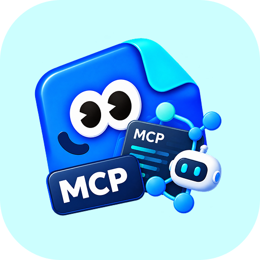
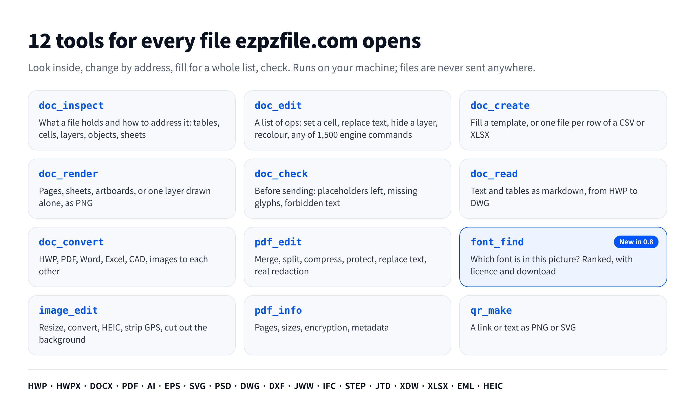

<p align="center">
  
</p>
<h1 align="center">ezpzfile-mcp</h1>
<p align="center"><b>English</b> · <a href="README.ko.md">한국어</a></p>
<p align="center">
  <a href="https://ezpzfile.com/mcp"></a>
</p>
<p align="center">
  <a href="https://www.npmjs.com/package/ezpzfile-mcp"></a>
  
  
  <a href="LICENSE"></a>
</p>

**File tools for AI agents: look inside a document, change it by address, fill it for a whole list, and check the result.**
HWP and HWPX without Hancom Office, Illustrator and Photoshop files without Adobe, DWG and Jw_cad without AutoCAD,
Ichitaro and DocuWorks without Windows, plus DOCX, PDF, Excel, images, and a font finder.
Everything runs on your machine and your files are never sent anywhere.

```bash
claude mcp add ezpzfile -- npx -y ezpzfile-mcp
```

<sub>Version 0.8.0 · Node 22.13 or newer · Claude Desktop, Cursor, VS Code: see the <a href="https://ezpzfile.com/mcp">guide</a></sub>

[](mcp/README.md#tools)

## What it saves

The same four files were placed in two sessions and the same task sentence was handed to the same model. One side could only use this server. The other had no dedicated tools and was free to use the shell and Node.

| | Without tools | With ezpzfile-mcp |
|---|---|---|
| Cost | $0.28 | **$0.13** |
| Wall time | 9:06 | **0:39** |
| Tasks finished | 2 / 4 | **4 / 4** |
| Tool calls | 20 | **10** |
| Tokens | 510,607 | **184,605** |

That is 53% less cost and 93% less time. Tokens and cost are the per-message figures the sessions recorded, added up, not estimates. Measured 2026-09-12. The bare session never started two of the tasks: it spent the clock hunting for libraries for the two Korean documents, so read the gap as a floor.

## Who it is for

Real jobs, run the way an agent runs them, with `node test/bench.mjs` on the files `test/make-samples.py` makes (Node 22.22.0, linux, 2 cores, 2026-11-05). "First run" includes one-time downloads (design engines, font finder models, a missing font).

| Who | Job | First run | Again | Result |
| --- | --- | --- | --- | --- |
| Office, Korea | Read every table of an HWP | 267 ms | 18 ms | tables as markdown, merged cells kept |
| Office, Korea | Fill an HWP form, convert to PDF, check | 1.3 s | 388 ms | 3 calls, nothing left |
| Sales | Quote from a DOCX template (split placeholder, item rows) | 374 ms | 348 ms | 1 call, 1 row added, nothing left |
| Sales | 100 quotes from a PDF design and a list | 12.9 s | 6.7 s | 100 files, 50 KB each, checked |
| Design | 100 business cards from an SVG/AI design and a list | 18 ms | 11 ms | 100 files |
| Design | PSD: hide a layer, save as PNG | 1.1 s | 1.0 s | 2 calls, 7 layers listed, confirmed |
| Design | Which font is this? (picture) | 6.0 s | 751 ms | #1 Nanum Myeongjo 92% |
| Design | Change a name in a PDF whose font is not installed | 836 ms | 92 ms | same font fetched, 67 KB |
| Privacy | Redact a name, phone and address in a PDF, prove it | 1.3 s | 914 ms | 2 calls, nothing left to extract |
| Architecture | CAD drawing: layers, text, vector PDF | 38 ms | 20 ms | 3 calls, text stays text |

- **Office workers in Korea and Japan:** HWP, HWPX, Ichitaro and DocuWorks read, filled, edited cell by cell and converted.
- **Sales and admin:** quotes, certificates and letters from DOCX, HWP or PDF templates, one file or one per row of a spreadsheet.
- **Designers and marketers:** AI, SVG and PSD changed layer by layer, a card or poster for every name on a list, the font of a reference picture.
- **Legal and privacy:** PDF redaction that removes the text, then proof that nothing can be extracted.
- **Architects and engineers:** DWG, DXF, Jw_cad, IFC and STEP read and printed to vector PDF with the text still text.

## MCP or a script

The same jobs done the way an agent does them without this server: a script with the common Python libraries, run on the same files.

| Job | ezpzfile-mcp | Script an agent writes |
| --- | --- | --- |
| Fill a DOCX quote template | 1 call, 0.1 s, nothing left | python-docx: `{{customer}}`, split over two runs by Word, stays unfilled |
| Redact a name and phone number in a PDF | 1 call, 1 s, text gone, checked | pypdf + reportlab black boxes: looks redacted, the name is still extractable |
| 100 quotes from a PDF design and a list | 1 call, 7 s, 50 KB each | pypdf + reportlab overlay: coordinates measured by hand, `{{owner}}` still in every file's text |
| Change an HWP table cell | 1 call, confirmed after reopening | no open library writes HWP tables |
| PSD: hide a layer, save as PNG | 2 calls, 0.9 s | psd-tools does this well (3.3 s); it cannot change a type layer's text |
| DXF to PDF | 1 call, 16 ms, text stays text | ezdxf + matplotlib (1.2 s): no text layer. DWG needs the closed ODA converter |
| Which font is this? | 1 call, 0.8 s, ranked with licence | no open library identifies a font from a picture |

## What's new in 0.8.0

- **`font_find`**: the text in a picture or a document page, matched against about 10,000 fonts in 10 scripts, the same way as [ezpzfile.com/fonts](https://ezpzfile.com/fonts).
- **Missing fonts fetched by name**: when a PDF template's font is not installed and it is a free Google Fonts family, it is downloaded once and used, not a look-alike.
- **Smaller batch PDFs**: 100 quotes went from 757 KB to 50 KB each, 43 s to 7 s.

All releases: [Releases](https://github.com/ezpzfile/ezpzfile-mcp/releases).

## Layout

| Path | What it is |
|---|---|
| [`mcp/`](./mcp) | The package: server, tools, tests, build. [`mcp/README.md`](./mcp/README.md) has every tool and argument |
| `src/lib/` | Code shared with [ezpzfile.com](https://ezpzfile.com): HWP, PDF, CAD, font finder |
| `engines/` | Patches that build the vector and PSD engines for WASI |
| `public/vendor/` | The HWP, JTD and XDW engines, libheif and bundled fonts (kept out of git; they ship inside the npm package) |

```bash
cd mcp
npm install
npm run build                            # mcp/dist/index.js, mcp/vendor/
python3 test/make-samples.py /tmp/samples
node test/protocol.mjs /tmp/samples      # every tool
node test/scenarios.mjs /tmp/samples     # jobs chained the way an agent does
node test/bench.mjs /tmp/samples         # the timings above
```

Network use is one-time downloads that upload nothing: the background-removal model, the design engines, the font finder's models and lists, and free fonts a PDF template names. `EZPZFILE_NO_FONT_DOWNLOAD=1` turns the font downloads off.

## A note on this repository

This is a read-only export. The working copy lives in a private monorepo alongside the website, and this repository is regenerated from it on each release. Please open issues rather than pull requests.

MIT licensed, see [LICENSE](./LICENSE). Bundled engines and fonts keep their own licences.
